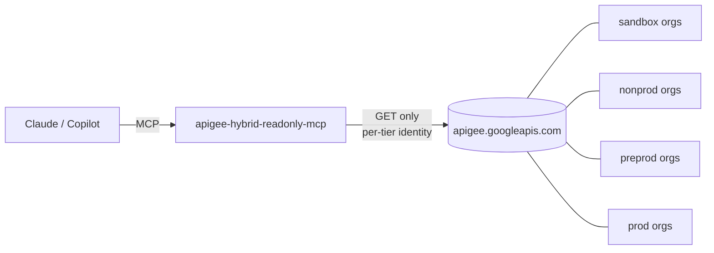

# Apigee Hybrid Read-Only MCP

`apigee-hybrid-readonly-mcp`

A **read-only** MCP server for the Apigee Hybrid control plane. It lets Claude, GitHub Copilot or any MCP client query orgs, environments, proxies, deployments, certificates, products, apps and analytics, across many orgs and tiers, with no way to change anything.



- **Multi-org:** a TOML registry groups orgs into tiers (sandbox / nonprod / preprod / prod) and, optionally, lines of business (payments, retail, ...). It gives them aliases and assigns a credential per tier. `payments@prod` names the one payments org in prod. Cross-org tools answer questions like "where is `orders` deployed, at which revision, in every prod org?"
- **Read-only in depth:** reader IAM roles, a GET-only client, strict path validation, an org allowlist, secret redaction, and `readOnlyHint` on every tool.
- **Any Google identity:** your `gcloud auth login`, ADC, SA key files, workload identity, and per-tier service-account impersonation.

## Quick start

Requires Python 3.11+.

```bash
git clone <this repo> && cd apigee-hybrid-readonly-mcp
python3 -m venv ~/.venvs/apigee-hybrid-readonly-mcp && ~/.venvs/apigee-hybrid-readonly-mcp/bin/pip install -e '.[google]'

mkdir -p ~/.config/apigee-hybrid-readonly-mcp
cp apigee-orgs.example.toml ~/.config/apigee-hybrid-readonly-mcp/apigee-orgs.toml   # edit: your orgs, tiers, reader SAs

gcloud auth login
APIGEE_CONFIG=~/.config/apigee-hybrid-readonly-mcp/apigee-orgs.toml ~/.venvs/apigee-hybrid-readonly-mcp/bin/apigee-hybrid-readonly-mcp --check
```

`--check` probes every configured org and prints `OK` or the reason it failed.

To query a single org without a config file:

```bash
APIGEE_AUTH=gcloud APIGEE_ORG=my-org apigee-hybrid-readonly-mcp --check
```

## Connect a client

| Client | How |
|---|---|
| Claude Code | `claude mcp add apigee-hybrid-readonly -e APIGEE_CONFIG=$HOME/.config/apigee-hybrid-readonly-mcp/apigee-orgs.toml -- ~/.venvs/apigee-hybrid-readonly-mcp/bin/apigee-hybrid-readonly-mcp` |
| Claude Desktop | Add it under `mcpServers` in `claude_desktop_config.json`, with the same command and env |
| VS Code Copilot (agent mode) | [`.vscode/mcp.json`](.vscode/mcp.json): see [docs/github-copilot.md](docs/github-copilot.md) |
| Copilot CLI / coding agent | [docs/github-copilot.md](docs/github-copilot.md) |

Run the prod-like tiers as a separate server entry with `APIGEE_TIERS=preprod,prod`. Reaching them is then a deliberate choice in the client.

## Configuration

See [`apigee-orgs.example.toml`](apigee-orgs.example.toml): 19 orgs in 4 tiers (sandbox, nonprod, preprod, prod), each tier impersonating its own reader SA. Preprod and prod each have one dedicated org per line of business (payments, retail, lending). Settings inherit defaults → tier → org. Define tiers and LOBs in the order you want them reported; tiers in promotion order.

### Lines of business

A line of business (LOB) is an optional second dimension across tiers:

```toml
[lobs.payments]
description = "Card and payment APIs"
orgs = ["acme-pay-pp", "acme-pay-prod"]   # or set lob = "payments" on each org
```

- Each org belongs to at most one LOB. Each LOB has at most one org per tier, and a duplicate is a config error.
- `org="payments@prod"` works anywhere an org is accepted, including `apigee_get` paths.
- `list_configured_orgs`, `across_orgs` and `find_api_deployments` take `lob=`, which combines with `tier=`. `find_api_deployments` also reports `revisionsByLob`, so preprod-to-prod drift per LOB shows in one call.
- LOBs group orgs only: credentials still come from the tier, or an org override.

| Env var | Purpose |
|---|---|
| `APIGEE_CONFIG` | Path to the TOML registry |
| `APIGEE_TIERS` | Limit this instance to some tiers, e.g. `sandbox,nonprod` |
| `APIGEE_ORG` / `APIGEE_ALLOWED_ORGS` | Single-credential setup without a config file |
| `APIGEE_AUTH` | `auto` (default), `adc` or `gcloud` |
| `APIGEE_IMPERSONATE_SERVICE_ACCOUNT`, `APIGEE_CREDENTIALS_FILE`, `APIGEE_GCLOUD_ACCOUNT` | Credential options without a config file |
| `APIGEE_ACCESS_TOKEN` | A static token for quick tests |
| `APIGEE_REDACT_SECRETS` | Default `true` |
| `APIGEE_MAX_RESPONSE_CHARS` | Text returned to the model per call. Default `120000`; longer output is truncated with a note. |
| `APIGEE_MAX_RESPONSE_BYTES` | Hard cap on an API response body. Default 20 MB; larger responses are refused. |
| `APIGEE_MAX_RETRIES` | Retries for 429, 5xx and network errors, with exponential backoff that honors `Retry-After`. Default `3`. |
| `APIGEE_TIMEOUT_S` | Per-request timeout, 1–300 seconds. Default `30`. |
| `LOG_LEVEL` | Default `INFO`. |

The config is validated strictly at startup, and the server refuses to start (exit code 2) on any problem:
- unknown keys, which catches typos such as `impersonate_serviceaccount`
- wrong types
- non-HTTPS API bases
- malformed names
- `APIGEE_TIERS` without a config file

A typo in a credential setting can therefore never silently fall back to a broader identity.

## Operations

- **Logs** go to stderr, since stdout is the MCP channel. Each API call logs one line: method, org, path, status, latency and attempt. Tokens and response bodies are never logged.
- **Tool errors** reach the client as MCP `isError: true` results with a readable message: HTTP status, rejected input, unknown org or auth failure. An unexpected bug is logged with a traceback, and the model sees only a generic error.
- **Token refresh:** a 401 triggers one token refresh and retry, which covers expired gcloud or ADC tokens.
- **Redirects** are never followed, so a bearer token can't be carried to another host.
- **Cross-org tools** report failures per org (`{"error", "status"}`), so one broken org never sinks the whole result.

Credentials are covered in full in [docs/authentication.md](docs/authentication.md).

## Tools (36, all read-only)

| Area | Tools |
|---|---|
| Multi-org | `list_configured_orgs`, `across_orgs`, `find_api_deployments` (filter by `tier` and/or `lob`) |
| Org | `list_organizations`, `get_organization`, `get_project_mapping`, `get_sync_authorization`, `list_operations` |
| Environments | `list_environments`, `get_environment`, `get_deployed_config`, `list_envgroups`, `get_envgroup` |
| Proxies / shared flows | `list_api_proxies`, `get_api_proxy`, `get_api_proxy_revision`, `list_sharedflows`, `get_sharedflow` |
| Deployments | `list_deployments`, `get_deployment_status` |
| Env config | `list_env_resources`, `get_target_server`, `get_keystore`, `get_flowhook`, `check_certificate_expiry` |
| KVMs | `list_kvms`, `list_kvm_entries` (values hidden unless the tier allows them) |
| Consumers | `list_api_products`, `get_api_product`, `list_developers`, `get_developer`, `list_apps`, `get_app` |
| Analytics / debug | `query_stats`, `list_debug_sessions` |
| Escape hatch | `apigee_get`: any GET under a configured org, with allowlisted query parameters; debug-session payloads are refused |

Example questions:
- "Which revision of `orders` is deployed in each org, and where do tiers drift?"
- "Is payments preprod ahead of payments prod for `checkout`?" (`find_api_deployments(api="checkout", lob="payments")`)
- "In payments@prod, is revision 12 of `checkout` fully rolled out on every pod?"
- "List the target servers in every nonprod org."
- "Which certs in retail@prod's prod environment expire within 60 days?"

## Docs

- [Build specification](docs/specification.md): the canonical, implementation-level spec (contracts, security rules, acceptance criteria, build plan)
- [Design and security model](docs/design.md), with architecture, sequence and auth diagrams
- [Authentication](docs/authentication.md): service accounts, user logins, impersonation and IAM setup
- [GitHub Copilot](docs/github-copilot.md): VS Code agent mode, Copilot CLI and the coding agent
- [Security audit](docs/security-audit.md): v0.3.0 findings and fixes
- [Changelog](CHANGELOG.md)

## Development

```bash
python -m unittest discover -s tests -v    # 86 tests, no network or credentials
```

Contribution rules for tools, which Copilot also reads, are in [.github/copilot-instructions.md](.github/copilot-instructions.md).
