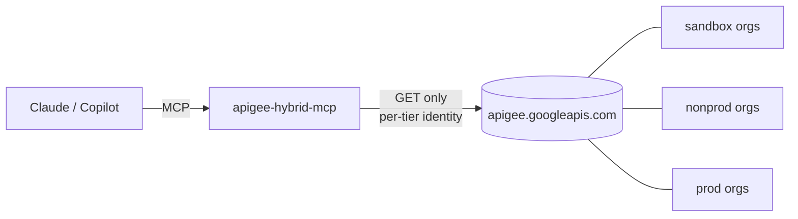

# apigee-hybrid-mcp

A **read-only** MCP server for the Apigee Hybrid control plane. It lets Claude, GitHub Copilot or any MCP client query orgs, environments, proxies, deployments, certificates, products, apps and analytics, across many orgs and tiers, with no way to change anything.



- **Multi-org:** a TOML registry groups orgs into tiers (sandbox / nonprod / prod), gives them aliases, and assigns a credential per tier. Cross-org tools answer questions like "where is `orders` deployed, at which revision, in every prod org?"
- **Read-only in depth:** reader IAM roles, a GET-only client, strict path validation, an org allowlist, secret redaction, and `readOnlyHint` on every tool.
- **Any Google identity:** your `gcloud auth login`, ADC, SA key files, workload identity, and per-tier service-account impersonation.

## Quick start

Requires Python 3.11+.

```bash
git clone <this repo> && cd apigee-hybrid-mcp
python3 -m venv ~/.venvs/apigee-mcp && ~/.venvs/apigee-mcp/bin/pip install -e '.[google]'

mkdir -p ~/.config/apigee-mcp
cp apigee-orgs.example.toml ~/.config/apigee-mcp/apigee-orgs.toml   # edit: your orgs, tiers, reader SAs

gcloud auth login
APIGEE_CONFIG=~/.config/apigee-mcp/apigee-orgs.toml ~/.venvs/apigee-mcp/bin/apigee-hybrid-mcp --check
```

`--check` probes every configured org and prints `OK` or the reason it failed.

To query a single org without a config file:

```bash
APIGEE_AUTH=gcloud APIGEE_ORG=my-org apigee-hybrid-mcp --check
```

## Connect a client

| Client | How |
|---|---|
| Claude Code | `claude mcp add apigee-hybrid -e APIGEE_CONFIG=$HOME/.config/apigee-mcp/apigee-orgs.toml -- ~/.venvs/apigee-mcp/bin/apigee-hybrid-mcp` |
| Claude Desktop | Add it under `mcpServers` in `claude_desktop_config.json`, with the same command and env |
| VS Code Copilot (agent mode) | [`.vscode/mcp.json`](.vscode/mcp.json): see [docs/github-copilot.md](docs/github-copilot.md) |
| Copilot CLI / coding agent | [docs/github-copilot.md](docs/github-copilot.md) |

Run prod as a separate server entry with `APIGEE_TIERS=prod`. Reaching prod is then a deliberate choice in the client.

## Configuration

See [`apigee-orgs.example.toml`](apigee-orgs.example.toml): 18 orgs in 3 tiers, each tier impersonating its own reader SA. Settings inherit defaults → tier → org.

| Env var | Purpose |
|---|---|
| `APIGEE_CONFIG` | Path to the TOML registry |
| `APIGEE_TIERS` | Limit this instance to some tiers, e.g. `sandbox,nonprod` |
| `APIGEE_ORG` / `APIGEE_ALLOWED_ORGS` | Single-credential setup without a config file |
| `APIGEE_AUTH` | `auto` (default), `adc` or `gcloud` |
| `APIGEE_IMPERSONATE_SERVICE_ACCOUNT`, `APIGEE_CREDENTIALS_FILE`, `APIGEE_GCLOUD_ACCOUNT` | Credential options without a config file |
| `APIGEE_ACCESS_TOKEN` | A static token for quick tests |
| `APIGEE_REDACT_SECRETS` | Default `true` |
| `APIGEE_MAX_RESPONSE_CHARS` | Default `120000` |

Credentials are covered in full in [docs/authentication.md](docs/authentication.md).

## Tools (36, all read-only)

| Area | Tools |
|---|---|
| Multi-org | `list_configured_orgs`, `across_orgs`, `find_api_deployments` |
| Org | `list_organizations`, `get_organization`, `get_project_mapping`, `get_sync_authorization`, `list_operations` |
| Environments | `list_environments`, `get_environment`, `get_deployed_config`, `list_envgroups`, `get_envgroup` |
| Proxies / shared flows | `list_api_proxies`, `get_api_proxy`, `get_api_proxy_revision`, `list_sharedflows`, `get_sharedflow` |
| Deployments | `list_deployments`, `get_deployment_status` |
| Env config | `list_env_resources`, `get_target_server`, `get_keystore`, `get_flowhook`, `check_certificate_expiry` |
| KVMs | `list_kvms`, `list_kvm_entries` (values hidden unless the tier allows them) |
| Consumers | `list_api_products`, `get_api_product`, `list_developers`, `get_developer`, `list_apps`, `get_app` |
| Analytics / debug | `query_stats`, `list_debug_sessions` |
| Escape hatch | `apigee_get` (any GET under a configured org) |

Example questions:
- "Which revision of `orders` is deployed in each org, and where do tiers drift?"
- "In prod-usw, is revision 9 of `orders` fully rolled out on every pod?"
- "List the target servers in every nonprod org."
- "Which certs in acme-prod-eu-west's prod environment expire within 60 days?"

## Docs

- [Design and security model](docs/design.md), with architecture, sequence and auth diagrams
- [Authentication](docs/authentication.md): service accounts, user logins, impersonation and IAM setup
- [GitHub Copilot](docs/github-copilot.md): VS Code agent mode, Copilot CLI and the coding agent

## Development

```bash
python -m unittest discover -s tests -v    # 40 tests, no network or credentials
```

Contribution rules for tools, which Copilot also reads, are in [.github/copilot-instructions.md](.github/copilot-instructions.md).
