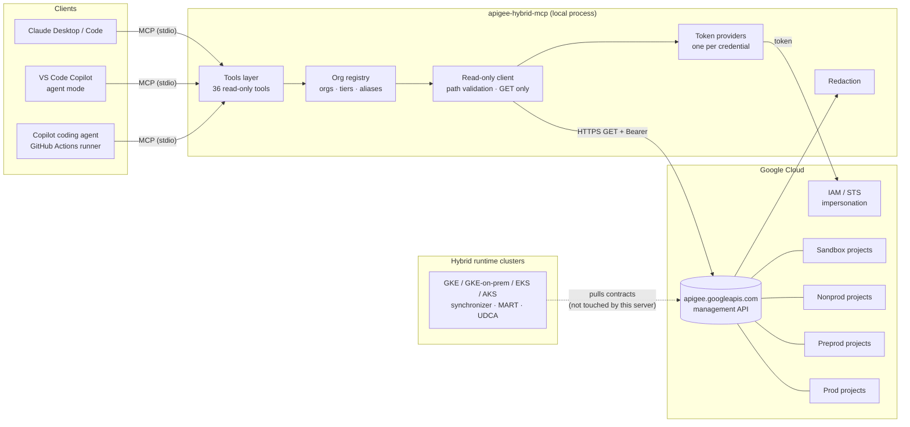
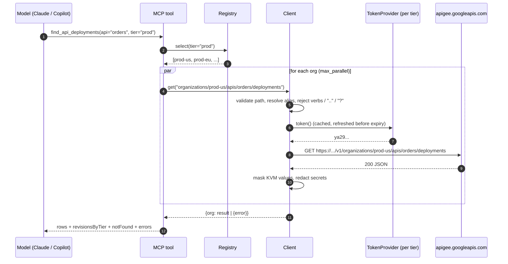
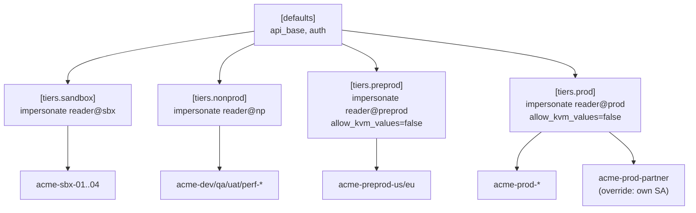
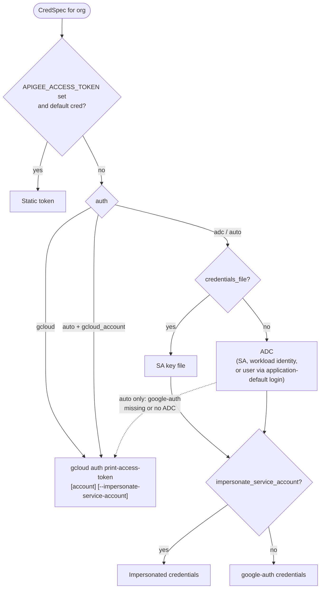

# Design: apigee-hybrid-mcp

**Status:** v0.2, implemented  
**Scope:** read-only access to the Apigee Hybrid control plane for AI assistants, across many orgs and tiers

## 1. Problem

The team runs about two dozen Apigee Hybrid orgs across sandbox, nonprod, preprod and prod. Answering routine questions means clicking through the console or hand-writing `curl` calls against `apigee.googleapis.com`, once per org. Typical questions:
- "Which revision of `orders` is live in each prod org?"
- "Is the rollout stuck on some pods?"
- "Which certs expire this month?"

The goal is to let an assistant (Claude, GitHub Copilot, any MCP client) answer these directly, with no way to change anything.

### Goals

- Read-only access to the management API, enforced in more than one layer.
- Many orgs, grouped into tiers, each tier with its own identity.
- Questions that span orgs, such as deployment drift and fleet-wide lists.
- Works with service accounts and with user logins (ADC or the gcloud CLI).
- No secrets reach the model by default.

### Non-goals

- Writes of any kind: deploy, undeploy, create, update, delete, starting debug sessions.
- Talking to the hybrid runtime plane (Kubernetes, Cassandra, MART/UDCA endpoints). Use `kubectl` / `apigeectl` for that.
- Hosting a multi-user service with its own end-user auth. The HTTP transport is for local or trusted use only.

## 2. Architecture

Each Hybrid org is backed by a GCP project. The management API is global (or regional, for data residency) and serves every org. Hybrid runtimes pull configuration from it through the synchronizer. This server sits beside the runtimes as another read-only API consumer.

### Components

| Module | Responsibility |
|---|---|
| `server.py` | MCP tool definitions, tool annotations, the `--check` CLI, and transport selection |
| `config.py` | `Registry`: loads TOML or env vars, resolves names and aliases, handles tier selection and setting inheritance |
| `auth.py` | `CredSpec` to `TokenProvider`: ADC, SA key, gcloud CLI, impersonation, static token |
| `client.py` | Validates paths, routes each request to the org's base URL and credential, allows only GET plus allowlisted read POSTs, fans out across orgs |
| `redact.py` | Masks credential-like fields in responses |

## 3. Request flow

When one org fails (403, 404, timeout), the error is reported inline for that org and the rest still return.

## 4. Configuration model

- Inheritable keys flow defaults → tier → org: `api_base`, `auth`, `impersonate_service_account`, `credentials_file`, `gcloud_account`, `allow_kvm_values`.
- Tiers are reported in the order they are defined in the file, which should be promotion order (sandbox → nonprod → preprod → prod). `find_api_deployments`, `list_configured_orgs` and `--check` all use that order.
- A tier can list its orgs compactly (`orgs = [...]`), so 24 orgs take about 30 lines. Org tables are only needed for aliases, descriptions or overrides.
- `APIGEE_TIERS=sandbox,nonprod` limits a server instance to some tiers. The recommended setup is a separate instance for the prod-like tiers (`preprod,prod`).
- Without a config file, env vars give either an allowlist (`APIGEE_ALLOWED_ORGS`) or open mode, where any org name is accepted and IAM alone decides.
- Validation runs at startup and fails closed: unknown tiers, duplicate or ambiguous aliases, conflicting tier membership, or a bad `auth` value.

## 5. Authentication

- One provider is built per distinct `CredSpec` and cached, so four tiers means four providers whatever the org count.
- google-auth providers refresh using the library's own validity check.
- gcloud CLI tokens are re-fetched after 45 minutes.
- The supported identities are listed in [authentication.md](authentication.md).

## 6. Security model

Defense in depth. Any single layer is meant to be sufficient on its own:

| Layer | Control | Failure it covers |
|---|---|---|
| IAM | Reader identities hold only `roles/apigee.readOnlyAdmin` | Any bug in this code |
| Method allowlist | `_send` refuses anything other than GET, or POST to `:getSyncAuthorization` | A tool or path that tries to write |
| Path validation | Must be `organizations/{known-org}/...`. Rejects `..`, `?`, `#`, `%`, `://` and `:verb` in sub-paths. Each segment is checked against a charset. | Prompt injection steering `apigee_get` to another org, project, host or custom method |
| Org registry | Unknown orgs fail before any network call. `APIGEE_TIERS` hides whole tiers. | The model guessing org names, or prod access from a dev-only setup |
| Redaction | Consumer keys and secrets, passwords, tokens and private keys are masked to the last 4 characters. KVM values are hidden per tier. | Secrets landing in chat transcripts or Copilot logs |
| MCP annotations | Every tool sets `readOnlyHint=true` and `destructiveHint=false` | Lets clients auto-approve safely. Copilot code review requires it. |

Residual risks:
- Analytics and debug-session data can contain business data. Restrict who can use the prod instance.
- The streamable HTTP transport has no client auth. Bind it to localhost, or put it behind IAP.

## 7. Tool surface

| Category | Tools |
|---|---|
| Multi-org | `list_configured_orgs`, `across_orgs`, `find_api_deployments` |
| Org | `list_organizations`, `get_organization`, `get_project_mapping`, `get_sync_authorization`, `list_operations` |
| Environments | `list_environments`, `get_environment`, `get_deployed_config`, `list_envgroups`, `get_envgroup` |
| Proxies / shared flows | `list_api_proxies`, `get_api_proxy`, `get_api_proxy_revision`, `list_sharedflows`, `get_sharedflow` |
| Deployments | `list_deployments`, `get_deployment_status` |
| Env config | `list_env_resources`, `get_target_server`, `get_keystore`, `get_flowhook`, `check_certificate_expiry` |
| KVM | `list_kvms`, `list_kvm_entries` |
| Consumers | `list_api_products`, `get_api_product`, `list_developers`, `get_developer`, `list_apps`, `get_app` |
| Analytics / debug | `query_stats`, `list_debug_sessions` |
| Escape hatch | `apigee_get` |

Design choices:
- **Curated tools plus one escape hatch.** Named tools give the model good descriptions and argument schemas. `apigee_get` covers the long tail, under the same guards.
- **The `org` argument takes a name or alias** and is optional when `default_org` is set.
- **Responses are compact JSON**, truncated at `APIGEE_MAX_RESPONSE_CHARS` with a message saying so.

## 8. Testing

`python -m unittest discover -s tests` runs 41 tests. No network or credentials are needed.

| File | Covers |
|---|---|
| `test_server.py` | Every tool path against a fake API. Asserts that every request is GET (or the one allowlisted POST), and that traversal, query injection, other orgs and write verbs are rejected before any request is sent. |
| `test_multi_org.py` | Config inheritance, aliases, per-tier credential and base-URL routing, provider caching, fan-out with partial failure, drift summary, `APIGEE_TIERS` |
| `test_auth.py` | gcloud user login, specific account, gcloud impersonation (including the warning-line output), ADC service account, ADC user impersonating a tier SA, auto fallback, static-token scoping |

## 9. Future work

- Fleet-wide certificate expiry: `check_certificate_expiry` over a tier.
- A drift report comparing revision bundles (policy diffs) between tiers.
- An optional MCP resource listing configured orgs, so clients can show them without a tool call.
- An HTTP transport with OAuth (MCP auth spec) for a shared team endpoint.
