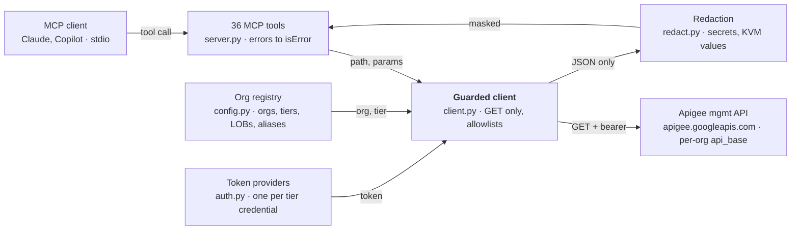

# Apigee Hybrid Read-Only MCP — Build Specification

Version 0.5.0 · Updated 2026-10-16 · Owner: Minh Trinh

> This file is the canonical spec. Change it in the same pull request as any behavior change.

## Purpose

This spec is enough to build Apigee Hybrid Read-Only MCP v0.5.0 from scratch, by hand or by handing it to Copilot or Claude. It describes behavior, contracts and the security rules that must hold. It contains no source code, so it can travel where the code can't.

The server is an MCP (Model Context Protocol) server. It lets an AI assistant query the Apigee Hybrid management API (`apigee.googleapis.com`) across about two dozen orgs in four tiers (sandbox, nonprod, preprod, prod). In preprod and prod, each line of business (LOB) has its own dedicated org. It never creates, changes, deploys or deletes anything.

The build is done when every item in **Acceptance criteria** passes, and `apigee-hybrid-readonly-mcp --check` reports every configured org as reachable.

How to use it:

- Build in the milestone order of **Build plan**. Each milestone ends with its tests passing.
- Exact rules (regexes, allowlists, limits) are normative. Prose around them explains why.
- Where this spec says "must", a test must enforce it.

## Goals and guarantees

The server answers routine fleet questions across all orgs without the ability to change anything. Example questions: which revision is live where, whether a rollout finished on every pod, which certs expire soon.

Goals:

- Read-only access to the Apigee management API, enforced in code and backed by IAM.
- Many orgs grouped into tiers, each tier with its own identity, and optionally into lines of business across tiers.
- Cross-org questions, such as deployment drift between tiers.
- Works with service accounts and with user logins (ADC or the gcloud CLI).
- No secrets reach the model by default.

Non-goals:

- Any write: deploy, undeploy, create, update, delete, starting a debug session.
- The Hybrid runtime plane (Kubernetes, Cassandra, synchronizer, MART). Use `kubectl` for that.
- A multi-user hosted service with its own end-user auth.

The four core guarantees. Every design rule below serves one of these, and tests must prove each:

| # | Guarantee | Primary control | Code-level control |
| --- | --- | --- | --- |
| G1 | Read-only: only GET leaves the process, plus POST to `:getSyncAuthorization` | IAM `roles/apigee.readOnlyAdmin` | Method allowlist checked at the lowest send layer |
| G2 | Only configured orgs, only the configured API host | Org registry | Path validation, alias resolution, no redirects |
| G3 | No secrets reach the model | Tool allowlist per client | Param allowlist, non-JSON fail-closed, redaction |
| G4 | Model-controlled input can't crash or escape the server | Typed tool schemas | Typed errors, bounds, fan-out cap |

Assume the model calling the tools may be prompt-injected. Every tool argument is untrusted input.

## Architecture

Six small modules, one network path. Tools never touch HTTP: every request goes through the guarded client, which resolves the org, gets that tier's token, validates the request, sends it, and redacts the response.



The guarded client is the only code that talks to the network, so all G1–G3 controls live there and every tool inherits them.

Request flow for one tool call:

1. The tool validates its own arguments with `seg()`, builds a path such as `organizations/{org}/environments/{env}`, and calls `client.get(path, params)`.
2. The client validates the path and resolves the org (name, alias or `lob@tier`) through the registry. That yields the org's API base, credential spec and KVM setting.
3. The client validates params, gets a token from the cached provider for that credential, and sends GET with retries.
4. The client refuses non-JSON, masks KVM values, runs `redact()`, and returns data.
5. The tool serializes with `to_text()`, truncating if needed. Any expected error becomes an MCP tool error.

## Tech stack and packaging

Python 3.11+ (needs `tomllib`), MCP Python SDK 2.x, no web framework.

| Dependency | Version | Use |
| --- | --- | --- |
| `mcp` | >=2.2,<3 | `MCPServer` (in 2.x, `FastMCP` was renamed: `from mcp.server.mcpserver import MCPServer`) |
| `mcp-types` | >=2.2,<3 | `ToolAnnotations` |
| `httpx2` | >=2.5,<3 | Async HTTP client (ships with mcp 2.x); `MockTransport` for tests |
| `pydantic` | >=2.12,<3 | Bounded tool arguments (`Annotated[int, Field(ge=, le=)]`) |
| `google-auth`, `requests` | extra `[google]` | ADC, SA key files, impersonation. Optional; gcloud CLI is the fallback |

If your work environment pins `mcp<2`, the equivalent v1 class is `FastMCP`, with the same decorator model. Check how your SDK version reports tool errors (see **Errors and MCP behavior**).

Packaging (`pyproject.toml`, hatchling):

- Distribution name `apigee-hybrid-readonly-mcp`; import package `apigee_hybrid_readonly_mcp` under `src/`.
- Version is single-sourced: `__version__ = "0.4.0"` in `__init__.py`, which also defines `PRODUCT_NAME = "Apigee Hybrid Read-Only MCP"`. Use `[tool.hatch.version] path` to read it.
- Console script `apigee-hybrid-readonly-mcp = ...server:main`.
- Declare every directly imported package explicitly, with upper bounds.

Repository layout:

```
apigee-hybrid-readonly-mcp/
  src/apigee_hybrid_readonly_mcp/
    __init__.py   version, product name
    config.py     org/tier registry, validation
    auth.py       token providers
    client.py     read-only HTTP client, path + param guards, retries
    redact.py     secret masking
    server.py     MCP tools, CLI entry point
  tests/          unittest suites, no network
  docs/           design, authentication, github-copilot, security-audit
  examples/       copilot-setup-steps.yml (template, not run here)
  .github/        ci.yml, copilot-instructions.md
  .vscode/mcp.json
  apigee-orgs.example.toml
  README.md  CHANGELOG.md  pyproject.toml  .gitignore
```

`.gitignore` must exclude the real `apigee-orgs.toml`, `*.key.json`, `gha-creds-*.json`, `.env` and `.DS_Store`.

## Configuration

Orgs live in a TOML registry (`APIGEE_CONFIG=/path/apigee-orgs.toml`). Settings inherit **defaults → tier → org**, so most orgs need only a tier. An optional second dimension, **line of business**, groups orgs across tiers. Validation is strict and fails closed: any problem stops startup with exit code 2.

### TOML schema

| Table | Allowed keys |
| --- | --- |
| top level | `default_org`, `defaults`, `tiers`, `lobs`, `orgs`, `redact_secrets` (bool, default true), `timeout_s` (1–300, default 30), `max_parallel` (1–32, default 6) |
| `[defaults]` | the inheritable keys |
| `[tiers.<name>]` | inheritable keys + `orgs` (list of org names) + `description` |
| `[lobs.<name>]` | `orgs` (list of org names), `description`. No credentials |
| `[orgs.<name>]` | inheritable keys + `tier`, `lob`, `aliases` (list), `description` |

Inheritable keys: `api_base`, `auth` (`auto` / `adc` / `gcloud`), `impersonate_service_account`, `credentials_file`, `gcloud_account`, `allow_kvm_values`.

```toml
default_org = "acme-sbx-01"
max_parallel = 6

[defaults]
api_base = "https://apigee.googleapis.com/v1"
auth = "gcloud"

[tiers.sandbox]          # tiers are listed in promotion order
impersonate_service_account = "apigee-mcp-reader@acme-apigee-sandbox.iam.gserviceaccount.com"
allow_kvm_values = true
orgs = ["acme-sbx-01", "acme-sbx-02"]

[tiers.nonprod]
impersonate_service_account = "apigee-mcp-reader@acme-apigee-nonprod.iam.gserviceaccount.com"
orgs = ["acme-dev-us", "acme-qa-us"]

[tiers.preprod]
impersonate_service_account = "apigee-mcp-reader@acme-apigee-preprod.iam.gserviceaccount.com"
orgs = ["acme-pay-pp", "acme-retail-pp"]

[tiers.prod]
impersonate_service_account = "apigee-mcp-reader@acme-apigee-prod.iam.gserviceaccount.com"
orgs = ["acme-pay-prod", "acme-retail-prod", "acme-prod-partner"]

[lobs.payments]          # LOBs are listed in reporting order
description = "Card and payment APIs"
orgs = ["acme-pay-pp", "acme-pay-prod"]

[lobs.retail]
orgs = ["acme-retail-pp", "acme-retail-prod"]

[orgs.acme-pay-prod]
aliases = ["pay"]
description = "Payments production; PCI scope"
```

### Rules

- **Promotion order.** Tiers are reported in the order their tables appear in the file, not alphabetically. Tiers seen only on orgs come after, alphabetically. Every cross-org output sorts by this order.
- **Unknown keys are errors** in every table. This is security-relevant: a typo such as `impersonate_serviceaccount` must not silently fall back to a broader default credential.
- **Names** (orgs, tiers, LOBs, aliases) match `^[A-Za-z0-9][A-Za-z0-9._-]{0,254}$`. An alias must not collide with another org or alias.
- An org listed under one tier but whose own table says another tier is an error. So is an undefined tier.
- **Lines of business.** An org belongs to at most one LOB, set by listing it in `[lobs.<name>] orgs` or with `lob = "<name>"` on the org. The following are errors:
    - an undefined LOB on an org (a typo guard)
    - an org whose own `lob` conflicts with the table that lists it
    - a LOB table listing an org that no tier or `[orgs]` table defines
    - **two orgs with the same (LOB, tier)**

  LOBs are a grouping only: credentials always come from defaults → tier → org. LOBs are reported in `[lobs]` table order, and orgs without a LOB are allowed.
- `impersonate_service_account` and `gcloud_account` must look like an email (`^[A-Za-z0-9._-]+@[A-Za-z0-9._-]+$`).
- `credentials_file` can't be combined with `auth = "gcloud"`. `~` is expanded.
- `api_base` must be `https://`, or `http://` only for `localhost` / `127.0.0.1` / `::1`. It must have no userinfo, query or fragment. A host outside `*.googleapis.com` is allowed (private endpoints, test doubles) but logs a warning that tokens go there.
- Bools accept true/false/1/0/yes/no/on/off; anything else is an error. Numbers outside their range are errors.
- `default_org` must resolve to a configured org.
- A missing file or invalid TOML raises a clear config error, not a stack trace.

### Environment variables

| Variable | Meaning |
| --- | --- |
| `APIGEE_CONFIG` | Path to the TOML registry |
| `APIGEE_TIERS` | Comma list; this instance serves only those tiers (e.g. `sandbox,nonprod`). Requires a config file or allowlist; an unknown tier is an error. The default org is dropped if outside the kept tiers. LOB definitions and order are kept |
| `APIGEE_ORG` / `APIGEE_ALLOWED_ORGS` | No-file mode: default org and allowlist. With neither a file nor an allowlist, **open mode** accepts any well-formed org name and IAM alone decides |
| `APIGEE_API_BASE`, `APIGEE_AUTH`, `APIGEE_IMPERSONATE_SERVICE_ACCOUNT`, `APIGEE_CREDENTIALS_FILE`, `APIGEE_GCLOUD_ACCOUNT`, `APIGEE_ALLOW_KVM_VALUES` | No-file equivalents of the inheritable keys |
| `APIGEE_ACCESS_TOKEN` | Static token for quick tests; used only by the plain default credential |
| `APIGEE_REDACT_SECRETS` | Default `true` |
| `APIGEE_TIMEOUT_S` | Default 30 |
| `APIGEE_MAX_RESPONSE_CHARS` | Text returned to the model per call, default 120000, truncated with a note |
| `APIGEE_MAX_RESPONSE_BYTES` | Hard cap on an API body, default 20 MB |
| `APIGEE_MAX_RETRIES` | Default 3 |
| `LOG_LEVEL` | Default `INFO` |

### Registry operations

- `resolve(name | alias | "lob@tier" | None)` returns the org's config. `None` means the default org. `payments@prod` returns the one payments org in prod. An unknown LOB, or a LOB with no org in that tier, raises `UnknownOrg` naming the tiers it does have. An unknown name raises `UnknownOrg` listing known orgs. Org names and aliases can't contain `@`, so `lob@tier` is unambiguous.
- `select(tier=None, orgs=None, lob=None)` returns orgs matching every given filter (AND). An unknown tier or LOB raises `UnknownOrg`. An explicit list is de-duplicated and **capped at 50 before anything is resolved**, so one call can't trigger thousands of requests in open mode.
- `tier_rank(tier)` and `lob_rank(lob)` give sort indexes. `lobs` lists the LOBs in order; `grid()` returns `{lob: {tier: org}}`.

## Authentication

Each org resolves to a frozen, hashable `CredSpec`. One token provider is built per distinct spec and cached, so four tiers means four providers whatever the org count. All tokens use the scope `https://www.googleapis.com/auth/cloud-platform`.

`CredSpec` fields: `auth` (`auto` | `adc` | `gcloud`), `impersonate_service_account`, `credentials_file`, `gcloud_account`. It also offers `is_default` (auto with nothing else set) and `describe()`, a human string for `--check` and `list_configured_orgs` such as "gcloud default credentials -> impersonate reader@…".

### Provider selection, in order

1. `APIGEE_ACCESS_TOKEN` is set **and** the spec is the plain default → static token. A tier that impersonates must never silently use the static token.
2. `auth = "gcloud"`, or `auto` with `gcloud_account` set → **gcloud CLI provider**. It runs `gcloud auth print-access-token [account] [--impersonate-service-account=SA]`. If gcloud isn't on PATH, that's an error.
3. Otherwise build **google-auth** credentials:
   - `credentials_file` set → a service-account key file. Otherwise → `google.auth.default()` (ADC: a service account, workload identity, or a user via `gcloud auth application-default login`).
   - With `impersonate_service_account`, wrap the source credentials in `impersonated_credentials.Credentials`, lifetime 3600 s.
4. Step 3 failed: with `auth = "adc"` or a key file → error. With `auto` → fall back to the gcloud CLI (plus impersonation if set). No gcloud either → error listing everything tried.

### Provider contract

Every provider has `description`, `async token() -> str` and `invalidate()`.

- **google-auth provider:** refresh in a worker thread under an async lock when `creds.valid` is false or after `invalidate()`. Wrap failures in `AuthError` with a one-line message bounded to 500 characters.
- **gcloud provider:** cache the token for 45 minutes (gcloud doesn't report expiry; tokens last 60). Run with `stdin=DEVNULL` and a 60 s timeout. Take the **last non-empty stdout line**, because gcloud prints a warning line first when impersonating. Map timeout, missing binary, non-zero exit and empty output to `AuthError`.
- **static provider:** `invalidate()` does nothing.

### Supported identities

| Identity | Config |
| --- | --- |
| Your user login via gcloud CLI | `auth = "gcloud"` (`gcloud_account` picks one of several) |
| Your user login via ADC | `auth = "adc"` or `auto` |
| Service account JSON key | `credentials_file` |
| SA activated in gcloud | `auth = "gcloud"`, `gcloud_account = "sa@…"` |
| Workload identity, GCE/GKE metadata, GitHub OIDC | `auth = "adc"` |
| Per-tier reader SA via impersonation (recommended) | `impersonate_service_account`, combined with any of the above |

Impersonation needs `roles/iam.serviceAccountTokenCreator` on the target SA. Each reader SA holds only `roles/apigee.readOnlyAdmin` in its tier's projects.

## HTTP client and read-only enforcement

One `ApigeeClient` owns all network access. Tools never build URLs or headers themselves; they call `client.get(path, params)` or the single `client.read_post(path)`. Every guard below runs before a byte leaves the process.

### Path validation (`_check_path`)

Input is a resource path relative to `/v1`, e.g. `organizations/acme/environments/prod/apis`.

1. It must be a string of at most 2048 characters. Strip whitespace and leading `/`, and drop a leading `v1/`.
2. The exact path `organizations` is allowed: it lists orgs and uses the default credential and API base.
3. Otherwise the first segment must be `organizations` with at least two segments. Segment 2 is `org[:verb]`; resolve `org` through the registry. Aliases become canonical names, and unknown orgs raise before any request.
4. A custom verb is allowed only on the org segment itself, with nothing after it. Any `:` in a later segment is refused.
5. **Every** later segment must match `^[A-Za-z0-9._@+-][A-Za-z0-9._@+ -]{0,254}$`. It must not consist only of dots, and must have no leading or trailing whitespace. This rejects `..`, `%`, `?`, `#`, `;`, `/`, `\`, `://`, control characters and unicode look-alikes. The single exception: in the segment right after `stats`, a comma-separated dimension list is allowed, with each part validated separately.
6. Encode spaces as `%20` exactly once, here. The tool-level `seg()` helper validates but doesn't encode.
7. Refuse, case-insensitively, any path matching `(^|/)debugsessions/[^/]+/data(/|$)`. Debug transaction data contains live request headers, bodies and variables. Listing sessions stays allowed.

### Method allowlist (G1)

- `get()` sends GET. It also allows exactly one custom GET verb: `:getProjectMapping`.
- `read_post()` sends POST with body `{}` only to `:getSyncAuthorization`.
- The low-level `_send()` re-checks: GET passes, POST passes only if the path ends in an allowlisted verb, and every other method raises. This guard must hold even when `_send` is called directly.

### Query parameter allowlist (G3)

Parameters are an **allowlist**, never a denylist. Google API system parameters must never pass: `callback` and `alt` change the response to JSONP or protobuf so JSON redaction never runs; `fields` strips the keys redaction relies on; `format=bundle` returns proxy ZIPs; and `$httpMethod`, `access_token`, `oauth_token`, `key`, `quotaUser` and `userProject` change the method or identity.

```
pageSize pageToken count startKey rows expand ids includeRevisions includeMetaData
includeCred includeCompany apiProduct apptype appType keyStatus status app filter
sharedFlows select timeRange timeUnit sortby sort limit offset topk tsAscending tzo
accuracy realtime aggTable
```

Values must be strings or numbers, at most 2000 characters. Bools become `true`/`false`. `None` and empty values are dropped.

### Sending

- Base URL and credential come from the org's config. Send `Authorization: Bearer <token>`, `Accept: application/json` and `User-Agent: apigee-hybrid-readonly-mcp/<version> (read-only)`.
- `follow_redirects=False`. A 3xx is an error, so a token can't be forwarded to another host.
- Timeouts: total = `timeout_s`, connect = min(10, `timeout_s`).
- Stream the body and abort past `APIGEE_MAX_RESPONSE_BYTES`.
- **Retries:** on 429, 500, 502, 503, 504 and transport errors (connect, read, reset), up to `APIGEE_MAX_RETRIES`. Backoff is `0.5 s × 2^(attempt-1) × jitter(0.5–1.5)`, at least `Retry-After`, at most 10 s.
- **401:** call `provider.invalidate()` once and retry. A second 401 is reported.
- **Logging:** one line per attempt on stderr: method, org, path, status, ms, attempt. Never the token, never bodies.

### Response handling

- Status 400 and above raises `ApigeeError(status, message, path)`. The message is `error.message` from the JSON body when present, whitespace-collapsed, passed through the free-text secret scan, and cut to 500 characters. A network failure after retries uses status 0 and says "Network error".
- An empty body returns `{}`.
- A JSON content type is parsed. Invalid JSON is an error, and so is `RecursionError` (deep nesting). If any path segment equals `keyvaluemaps` (case-insensitive) and the org doesn't allow KVM values, every `value` field at any depth becomes `<hidden: set allow_kvm_values for this tier/org to show>`. Then `redact()` runs, unless redaction is disabled.
- **Non-JSON fails closed.** Only paths matching `/resourcefiles/<type>/<name>$` may return text. That text is decoded, truncated, and passed through the free-text scan. Anything else non-JSON is refused as "unexpected non-JSON response".

### Fan-out (`for_each_org`)

Run one coroutine per org under a semaphore of `max_parallel`. An expected error becomes `{"error": message, "status": http_status or null}` for that org. An unexpected exception is logged with its traceback and becomes `{"error": "internal error (see server log)"}`. One org never fails the whole result.

## Redaction

`redact(obj)` returns a masked deep copy of every JSON response. A masked string keeps its last 4 characters (`****abcd`); strings of 8 characters or fewer become `****`. Redaction is a heuristic second layer; IAM and the tool allowlist stay primary.

### Rules, applied recursively

1. **Secret key.** A key whose name matches the secret pattern, and isn't an exact metadata name, has its **whole value** masked. That covers strings, numbers (`****`), every element of a list, and every leaf of a nested object. `None` and bools are kept.
2. **Name/value attribute.** In an object with a `value` key whose `name` matches the secret pattern, mask `value`. This is how Apigee stores app, product and developer attributes.
3. **JWK.** In an object that has `kty`, mask the private members `d`, `p`, `q`, `dp`, `dq`, `qi` and `k`. Public members such as `n` stay.
4. **Every string** goes through the free-text scan below.

Secret pattern (case-insensitive, searched anywhere in the name):

```
secret | password | passwd | passphrase | pass[_-]?word | private[_-]?key | consumer[_-]?key
| client[_-]?(key|id)$ | api[_-]?keys?$ | ^apikey | token | credential | basic[_-]?auth
| auth[_-]?(header|token|key|code) | ^authorization$ | ^key$ | ^keys?value$ | access[_-]?key
| (hmac|shared|encryption|signing|master|session)[_-]?key | cookie | ^pin$ | passcode | ^otp$
```

Metadata names that must **not** be masked (exact match only, case-insensitive): `credentials`, `tokenType`, `tokenEndpoint`, `expiresAt`, `expiresIn`, `issuedAt`, `accessTokenExpiry`, `tokenExpiry`, `credentialsCount`. Check the secret pattern **first** and allow only these exact names. A broad allowlist (such as anything containing `truststore`) leaked `truststore_password` in review.

### Free-text scan (`mask_text`)

Applied to JSON strings, resource-file text and error messages:

- PEM and PGP private-key blocks (`-----BEGIN …PRIVATE KEY…-----` up to any `-----END …-----`, or end of text) become `<redacted …PRIVATE KEY>`.
- `Basic`, `Bearer` and `Digest` followed by 8 or more token characters become `Basic ****`.
- `name = value`, `name: value` and `"name": "value"`, where the name contains secret, password, passwd, passphrase, private key, api key, token, credential, access key, client id or consumer key: mask the value.
- `<SecretName>value</SecretName>` in XML: mask the inner value.

### Analytics dimensions

If a stats query requests a credential dimension (`client_id`, `api_key`, `access_token`, `developer_app_key`, `consumer_key`), mask those values in `environments[].dimensions[].name`. Multi-dimension values are comma-joined in request order: mask by position, and if the part count doesn't match, mask every part.

### Must keep (false-positive guard)

These must pass through unchanged: target servers (host, port, sslInfo, keyStore, keyAlias, trustStore), products, keystore aliases and cert info, deployments, environments, operations, attribute pairs with ordinary names, `keyAliasReference`, `status`, `apiProducts`, and `expiresAt` / `issuedAt` on credentials.

## Tool catalog

There are 36 tools. Every one takes an optional `org` (name or alias; omitted means the default org), except the four marked *multi*. Paths are relative to `/v1`, with `O` = `organizations/{org}`. Every caller-supplied path piece passes `seg()`. Every tool returns compact JSON text (`json.dumps(indent=1)`), truncated at `APIGEE_MAX_RESPONSE_CHARS` with a note telling the model to narrow the query or page.

### Organization

| Tool | Arguments | Endpoint |
| --- | --- | --- |
| `list_organizations` | — | GET `organizations` |
| `get_organization` | — | GET `O` |
| `get_project_mapping` | — | GET `O:getProjectMapping` |
| `get_sync_authorization` | — | POST `O:getSyncAuthorization` (the only POST) |
| `list_operations` | `filter`, `page_size` 1–1000 = 50 | GET `O/operations` |

### Environments

| Tool | Arguments | Endpoint |
| --- | --- | --- |
| `list_environments` | — | GET `O/environments` |
| `get_environment` | `env` | GET `O/environments/{env}` |
| `get_deployed_config` | `env` | GET `O/environments/{env}/deployedConfig` |
| `list_envgroups` | — | GET `O/envgroups` |
| `get_envgroup` | `envgroup` | GET the group and `…/attachments` concurrently; return `{envgroup, attachments}`, where a non-dict attachments response becomes `[]` |

### Proxies, shared flows, deployments

| Tool | Arguments | Endpoint |
| --- | --- | --- |
| `list_api_proxies` | `include_revisions` = false | GET `O/apis?includeRevisions=` |
| `get_api_proxy` | `api` | GET `O/apis/{api}` |
| `get_api_proxy_revision` | `api`, `revision` | GET `O/apis/{api}/revisions/{rev}` |
| `list_sharedflows` | `include_revisions` | GET `O/sharedflows` |
| `get_sharedflow` | `sharedflow` | GET `O/sharedflows/{sf}` |
| `list_deployments` | `env`?, `api`?, `sharedflows` = false | both set: `O/environments/{env}/{apis\|sharedflows}/{api}/deployments`; env only: `O/environments/{env}/deployments`; api only: `O/{kind}/{api}/deployments`; neither: `O/deployments` (+ `sharedFlows=true` when asked) |
| `get_deployment_status` | `env`, `api`, `revision`, `sharedflow` = false | GET `O/environments/{env}/{kind}/{api}/revisions/{rev}/deployments` (per-pod rollout state) |

### Environment config

| Tool | Arguments | Endpoint |
| --- | --- | --- |
| `list_env_resources` | `env`, `resource` ∈ targetservers, keystores, references, resourcefiles, flowhooks, caches, keyvaluemaps | GET `O/environments/{env}/{resource}` |
| `get_target_server` | `env`, `name` | GET `…/targetservers/{name}` |
| `get_keystore` | `env`, `keystore`, `alias`? | GET `…/keystores/{ks}[/aliases/{alias}]` |
| `get_flowhook` | `env`, `flowhook` ∈ Pre/PostProxyFlowHook, Pre/PostTargetFlowHook | GET `…/flowhooks/{hook}` |
| `check_certificate_expiry` | `env`, `warn_days` 0–3650 = 30 | List keystores, then each keystore's aliases, then each alias, concurrently under `max_parallel`. Return certs sorted by days left with status EXPIRED / EXPIRING / OK / UNKNOWN (an unparseable `expiryDate`, epoch ms). Unreadable keystores or aliases are listed under `errors`, not fatal |

### KVMs

| Tool | Arguments | Endpoint |
| --- | --- | --- |
| `list_kvms` | `scope` ∈ org/env/proxy = env, `env`?, `api`? | GET `O[/environments/{env}\|/apis/{api}]/keyvaluemaps`. A missing `env` or `api` for its scope is a tool error |
| `list_kvm_entries` | `kvm`, scope args, `page_size` 1–1000 = 100, `page_token` | GET `…/keyvaluemaps/{kvm}/entries`. Values are hidden unless the tier allows them |

### Products, developers, apps

| Tool | Arguments | Endpoint |
| --- | --- | --- |
| `list_api_products` | `expand`, `count` 1–1000 = 100, `start_key` | GET `O/apiproducts` |
| `get_api_product` | `product` | GET `O/apiproducts/{p}` |
| `list_developers` | `expand`, `count`, `start_key` | GET `O/developers` |
| `get_developer` | `email` | GET `O/developers/{email}` |
| `list_apps` | `developer`?, `expand`, `rows` 1–1000, `start_key` | GET `O/developers/{dev}/apps` or `O/apps` |
| `get_app` | `app_id` | GET `O/apps/{id}`. Credentials are masked |

### Analytics and debug

| Tool | Arguments | Endpoint |
| --- | --- | --- |
| `query_stats` | `env`, `dimensions` (comma list, at least one), `select` = `sum(message_count)`, `time_range` (default: the last 24 h in UTC, `MM/DD/YYYY HH:MM~MM/DD/YYYY HH:MM`), `time_unit`?, `filter`?, `sort_by`? (sets `sort=DESC`), `limit` 1–14400 = 50 | GET `O/environments/{env}/stats/{dims}`, then mask credential dimensions |
| `list_debug_sessions` | `env`, `api`, `revision` | GET `…/revisions/{rev}/debugsessions` (a list only; never session data) |

### Multi-org

| Tool | Arguments | Behavior |
| --- | --- | --- |
| `list_configured_orgs` *multi* | `tier`?, `lob`? | Config source, default org, open mode, tiers in promotion order, `lobs` (name, description), a `grid` of `{lob: {tier: org}}`, and each org's name, tier, lob, aliases, description and `credential` (from `describe()`). Makes no API call |
| `across_orgs` *multi* | `resource` (path relative to the org), `tier`?, `lob`?, `orgs`? (at most 50; names, aliases or `lob@tier`), `params`? | GET `organizations/{o}/{resource}` for each selected org (filters combine). Returns `{resource, tier, lob, orgCount, results: {org: data \| {error, status}}}`. An empty `resource` or one starting with `organizations` is a tool error |
| `find_api_deployments` *multi* | `api`, `tier`?, `lob`?, `orgs`?, `sharedflow` = false | GET `organizations/{o}/{kind}/{api}/deployments` per org. Returns `revisionsByTier` (tier → numeric-sorted revisions, in promotion order), `revisionsByLob` (`{lob: {tier: revisions}}`, so per-LOB preprod→prod drift shows in one call), `deployments` rows (org, tier, lob, environment, revision, deployStartTime; or "exists, not deployed"; sorted by LOB, then tier), `notFound` (decided by `status == 404`, never by matching message text) and `errors` |
| `apigee_get` *multi* | `path`, `params`? | Escape hatch: GET any path under a configured org, through every guard above |

Write the server instructions string (`MCPServer(instructions=...)`) to tell the model four things: call `list_configured_orgs` first, any `org` accepts a name, alias or `lob@tier`, use the multi-org tools (filtered by `tier` and/or `lob`) for cross-org questions, and expect credential fields to be masked.

## Errors, MCP behavior and CLI

Expected failures reach the client as MCP tool errors (`isError: true`) with a readable message. Bugs never leak internals.

### Errors

- Expected error types: `ApigeeError` (HTTP status or network), `ForbiddenOperation` (a guard refused the input), `UnknownOrg` (an unknown org or tier, or too many orgs) and `AuthError`.
- Every tool is registered through one decorator. It wraps the function so those four types become the SDK's `ToolError` (in mcp 2.x, `mcp.server.mcpserver.exceptions.ToolError`), which the SDK returns as `isError: true` with the message. Any other exception is a bug: the SDK logs a traceback and the model sees only "Error executing tool \<name>".
- **Never** return error text as a normal successful result: clients can't tell it from data.
- The same decorator sets `ToolAnnotations(readOnlyHint=True, destructiveHint=False, idempotentHint=True, openWorldHint=True)` on every tool, so clients may auto-approve them. Copilot code review only uses tools with `readOnlyHint`.
- Bounded integers use `Annotated[int, Field(ge=…, le=…)]`, so the SDK rejects them before the tool runs.

### Server identity and lifecycle

- `MCPServer(name="apigee-hybrid-readonly", title="Apigee Hybrid Read-Only MCP", version=__version__, instructions=…, lifespan=…)`. The lifespan closes the HTTP client on shutdown.
- Build the client lazily on first use, with a `set_client()` hook so tests can inject a mock transport.

### CLI (`apigee-hybrid-readonly-mcp`)

| Flag | Behavior |
| --- | --- |
| (none) | Serve MCP over stdio (default) |
| `--transport streamable-http --host --port` | HTTP transport, default `127.0.0.1:8080`. A non-loopback host logs a warning that there's no client authentication |
| `--check` | Probe GET `organizations/{org}` for every configured org through the fan-out. Print one line per org in promotion order, then LOB order (`[tier] lob org credential OK (HYBRID)` or `FAIL: …`; the LOB column appears only when LOBs are configured) and a total. Exit 1 if any org fails. In open mode, probe the default org or list orgs |
| `--version` | Print `apigee-hybrid-readonly-mcp <version>` |

Startup:

- Configure logging on stderr with timestamps (`force=True`, since the SDK installs its own handler). Set httpx loggers to WARNING. stdout is the MCP channel and must stay clean.
- Load the registry and build the client **before** serving. A `ConfigError` or `AuthError` prints `configuration error: …` and exits with code 2.
- Log a one-line summary: version, org count, tiers, open mode, redaction. Warn when open mode is on or redaction is off.

## Testing and acceptance criteria

The original has 101 offline tests (stdlib `unittest`, no network, no credentials). Every test builds a client on `httpx2.MockTransport` and calls tools exactly as a client would: `asyncio.run(mcp.call_tool(name, args))`, with `ToolError` meaning a tool error and `UnexpectedToolError` failing the test. Inject token providers through a factory, so per-tier routing is visible in the `Authorization` header.

Two patterns are mandatory:

- Every suite's `tearDown` asserts that **every request sent was GET**, or POST to `:getSyncAuthorization`.
- Every refused input asserts that **no request was sent**.

After writing the guards, mutation-check them: disable each guard and confirm a test fails. All 24 mutations failed a test in the original.

### Acceptance criteria

G1 read-only:

- [ ] Only GET leaves the process, plus POST to `:getSyncAuthorization`; `_send` refuses PATCH/DELETE/other POSTs even when called directly
- [ ] Custom verbs (`:generateDeployChangeReport`, `:setSyncAuthorization`, `org:x/y`) are refused
- [ ] `$httpMethod`, `httpMethod`, `method`, `_method`, `X-HTTP-Method-Override`, `access_token`, `oauth_token`, `key`, `upload_protocol`, `uploadType`, `callback`, `alt`, `fields`, `format`, `prettyPrint`, `quotaUser`, `userProject` are refused as params

G2 scoping:

- [ ] Unknown orgs and tiers are refused before any request; aliases resolve, including inside `apigee_get` paths
- [ ] `..`, `.`, `...`, `%2e%2e`, `a;b`, fullwidth characters, `\n`, leading/trailing spaces, `a?b`, `a#b`, `a/b`, `a:b`, over-long segments and `https://` paths are refused
- [ ] Commas are allowed only in the stats dimension segment
- [ ] Spaces are encoded once (`My App` becomes `My%20App`)
- [ ] Redirects are not followed
- [ ] Each tier's token and API base are used for its orgs; providers are cached per credential (2 tiers means 2 providers)
- [ ] `APIGEE_TIERS` hides other tiers' orgs and aliases

G3 secrets:

- [ ] App consumer key and secret are masked; attribute `{name: client_secret}` and `{name: client_id}` values are masked
- [ ] JSONP / proto / SSE responses on non-resource paths are refused
- [ ] Debug-session data paths are refused (case-insensitive); listing sessions works
- [ ] Resource-file text masks `db.password=`, `Basic …` and `<ClientSecret>`, and keeps `host=db.local`
- [ ] KVM values are hidden at any depth, on org/env/proxy paths and on `keyValueMaps`
- [ ] Masked in review fixtures: `truststore_password`, `tokenEndpointClientSecret`, `secretManagerToken`, `keyAliasPassword`, `basic_auth`, `access_key`, `hmacKey`, `sharedKey`, `encryptionKey`, `cookie`, nested `password` objects, `apiKeys` lists, numeric `pin`, JWK `d`/`p`, PGP keys
- [ ] Kept: JWK `n`, credential `status`, `apiProducts`, `keyAliasReference`, `name`, and the realistic payloads in **Redaction**
- [ ] Stats `client_id` values are masked, including in multi-dimension names
- [ ] Error messages are scanned (`client_secret=X` is masked)
- [ ] The bearer token never appears in errors or logs

G4 robustness:

- [ ] 503 × 2 then 200 succeeds; persistent 429 stops after the retry limit; a network error becomes status 0, not a crash; a 401 then 200 refreshes once
- [ ] Oversized, invalid and deeply nested JSON bodies become errors
- [ ] Failures return `isError: true`; out-of-range `count` / `limit` / `warn_days` are rejected before any request
- [ ] The cert scan survives a 403 alias and an unparseable date; `find_api_deployments` tolerates `deployments: "not-a-list"`
- [ ] One org raising an unexpected exception doesn't sink the fan-out; 500 orgs in open mode is refused; duplicate orgs are collapsed
- [ ] Every one of the 36 tools runs with minimal arguments against an empty `{}` response without error (smoke test)

Lines of business:

- [ ] An org's LOB can be set from a `[lobs]` table or on the org; orgs without a LOB are allowed
- [ ] `payments@prod` resolves in `org` arguments, `orgs` lists and `apigee_get` paths; an unknown LOB, or a LOB missing that tier, is a tool error with no request sent
- [ ] `lob=` filters `list_configured_orgs`, `across_orgs` and `find_api_deployments`, and combines with `tier=`
- [ ] `find_api_deployments` returns `revisionsByLob` per tier and a `lob` on every row
- [ ] Credentials come from the tier, not the LOB
- [ ] Config errors: two orgs for one (LOB, tier), an undefined LOB, conflicting membership, a LOB listing an unknown org, credential keys in a `[lobs]` table
- [ ] LOB order survives `APIGEE_TIERS`; `--check` shows the LOB column

Config and CLI:

- [ ] Unknown keys (`impersonate_serviceaccount`, `api-base`), bad types and ranges, non-https `api_base`, bad emails, a missing default org, a missing file and invalid TOML each raise `ConfigError`
- [ ] Tiers come out in file order; the example config loads 19 orgs in 4 tiers and 3 LOBs
- [ ] gcloud: user login, a specific account, impersonation with a warning line, timeout, empty output, missing binary, and `invalidate()` refetching
- [ ] A bad config makes `main` exit 2; `--version` prints the version; `--check` exits 1 on any failed org
- [ ] End to end over real stdio with the MCP client: the server reports name, title and 36 tools; errors arrive as `isError`

## Client integration and IAM

Run the prod-like tiers as a **separate server entry** (`APIGEE_TIERS=preprod,prod`), so reaching them is a deliberate choice in the client.

### IAM

Create one reader SA per tier. Grant it `roles/apigee.readOnlyAdmin` in every project of that tier: a Hybrid org's name is its GCP project ID by default. Grant your user or team group `roles/iam.serviceAccountTokenCreator` on each reader SA.

```bash
SA=apigee-mcp-reader@<tier-project>.iam.gserviceaccount.com
for ORG in <org1> <org2>; do
  gcloud projects add-iam-policy-binding "$ORG" --member="serviceAccount:$SA" \
    --role=roles/apigee.readOnlyAdmin --condition=None
done
gcloud iam service-accounts add-iam-policy-binding "$SA" \
  --member="group:<team>@<company>.com" --role=roles/iam.serviceAccountTokenCreator
```

### Clients

| Client | Configuration |
| --- | --- |
| Claude Code | `claude mcp add apigee-hybrid-readonly -e APIGEE_CONFIG=… -e APIGEE_TIERS=sandbox,nonprod -- <venv>/bin/apigee-hybrid-readonly-mcp` |
| VS Code Copilot (agent mode) | `.vscode/mcp.json` with a top-level `servers` key, two stdio entries (`apigee-hybrid-readonly`: sandbox + nonprod; `apigee-hybrid-readonly-prod`: preprod + prod), `${userHome}` paths |
| Copilot CLI | `~/.copilot/mcp-config.json`, `mcpServers` key, `"type": "local"`, `"tools": ["*"]` |
| Copilot coding agent | Repo Settings → Copilot → MCP servers JSON (`mcpServers`, `type: local`, explicit `tools` allowlist), plus a `copilot-setup-steps.yml` workflow in the target repo |

### Copilot coding agent

The agent uses MCP tools without asking, so restrict it hard:

- Sandbox and nonprod only.
- Its own SA through workload identity federation (an OIDC pool and provider limited to the one repo, `roles/iam.workloadIdentityUser`). No keys.
- An explicit tool allowlist that excludes `query_stats`, `list_debug_sessions`, `list_apps`, `get_app`, `list_developers`, `get_developer`, `list_kvm_entries` and `apigee_get`.

The setup workflow template lives at `examples/copilot-setup-steps.yml` in this repo, so it doesn't run here. The job must be named exactly `copilot-setup-steps`, in environment `copilot`, with `id-token: write`. Its steps:

1. Install the server into `/home/runner/apigee-hybrid-readonly-mcp` from `vars.APIGEE_MCP_SOURCE`. For a private repo, that pip URL needs a read-only token.
2. Run `google-github-actions/auth@v3` with the WIF provider and SA.
3. Move the generated `gha-creds-*.json` out of the checkout to `/home/runner/gcp-adc.json`, so the agent can't commit it.
4. Write `vars.APIGEE_ORGS_TOML` to `/home/runner/apigee-orgs.toml`.
5. Run `--check` with `APIGEE_AUTH=adc`, `APIGEE_TIERS=sandbox,nonprod`, and `GOOGLE_APPLICATION_CREDENTIALS` pointing at the moved file.

The MCP JSON sets the same three env values.

### Repository extras

- `.github/workflows/ci.yml`: Python 3.11 / 3.12 / 3.13 matrix, `pip install -e .`, the unit tests, and a check that the example config loads.
- `.github/copilot-instructions.md`: the contribution rules for tools. Use the decorator; only `get()`; `seg()` every argument; optional `org`; fan-out through `select` + `for_each_org`; return `to_text`; never add system params to the allowlist or relax fail-closed / debug-data rules; every change ships with mock-transport tests.

## Build plan

Build in this order. Each milestone ends green before the next starts; the guards come before the tools so no tool ever exists unguarded.

1. **Skeleton.** `pyproject.toml`, package with `__version__` and `PRODUCT_NAME`, `.gitignore`, empty test suite running in CI.
2. **Config registry.** `config.py` with the full TOML schema, inheritance, promotion order, lines of business and `lob@tier` resolution, strict validation, env mode, open mode, `APIGEE_TIERS`, `select` with the 50-org cap. Tests: every config criterion.
3. **Auth.** `CredSpec`, the three providers, selection order, `invalidate()`. Tests: gcloud and ADC paths with mocked subprocess and a fake google-auth module.
4. **Read-only client.** Path validation, method allowlist, param allowlist, debug-data block, retries, 401 refresh, size cap, no redirects, non-JSON fail-closed, fan-out. Tests: G1, G2, G4.
5. **Redaction.** `redact`, `mask_text`, KVM masking, false-positive guard. Tests: G3, including the realistic-payload check.
6. **Tools.** The decorator (annotations + `ToolError` mapping), then all 36 tools, the instructions string and stats dimension masking. Tests: per-tool behavior plus the every-tool smoke test.
7. **CLI and lifecycle.** `main`, `--check`, `--version`, transports, logging, fail-fast exit 2, lifespan close. Tests: CLI criteria, then an end-to-end stdio run with the MCP client against a local mock.
8. **Hardening review.** Mutation-check every guard. Have someone (or a separate AI session) who hasn't seen the code try to break G1–G4 from this spec alone.
9. **Docs and integration.** README, the design / authentication / Copilot docs, example config, `.vscode/mcp.json`, the Copilot setup template under `examples/`, CI matrix, `copilot-instructions.md`. Run `--check` against real orgs.

### Prompt for an AI assistant

Paste this, followed by the full spec:

```text
You are building "Apigee Hybrid Read-Only MCP", a Python 3.11+ MCP server (MCP SDK 2.x MCPServer,
httpx2, pydantic, optional google-auth) that gives an AI assistant READ-ONLY access to the Apigee
management API across many orgs grouped into tiers and lines of business. The specification below is normative: exact
regexes, allowlists, limits and tool contracts must be implemented as written.

Work milestone by milestone in the order of "Build plan". For each milestone:
1. Write the tests first from "Testing and acceptance criteria", using httpx2.MockTransport and
   calling tools through mcp.call_tool exactly as a client would. Every suite asserts that every
   request sent was GET (or POST to :getSyncAuthorization), and every refused input sent nothing.
2. Implement until the tests pass. Do not move on with failing tests.
3. Show me the diff and the test output, then wait for "next".

Treat every tool argument as untrusted, as if the calling model were prompt-injected. Never add an
HTTP method, never use a denylist where the spec says allowlist, never return errors as normal
results, and never log tokens or response bodies. If the spec is ambiguous, ask instead of guessing.

<paste the specification here>
```

Check your employer's policy on using AI tools with internal code before pasting the spec into an assistant. The spec contains no secrets or org names, but your config will.
